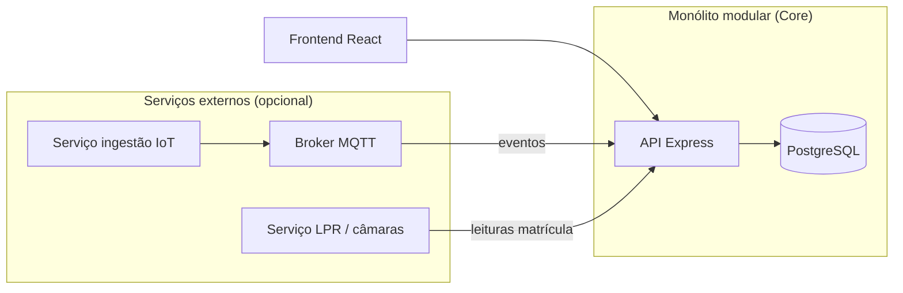
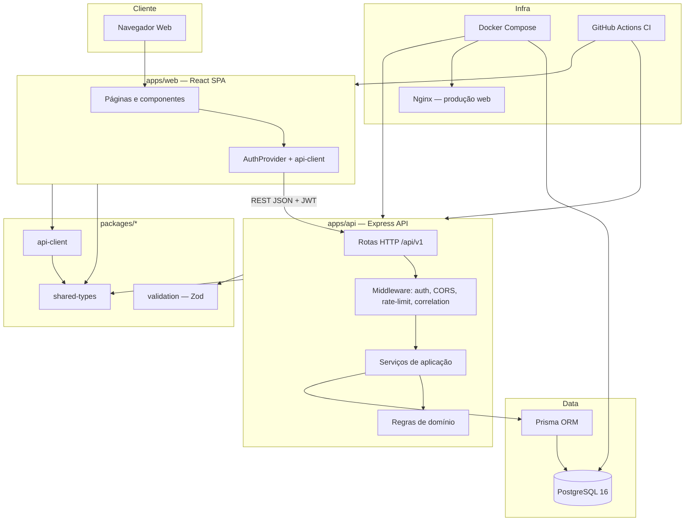
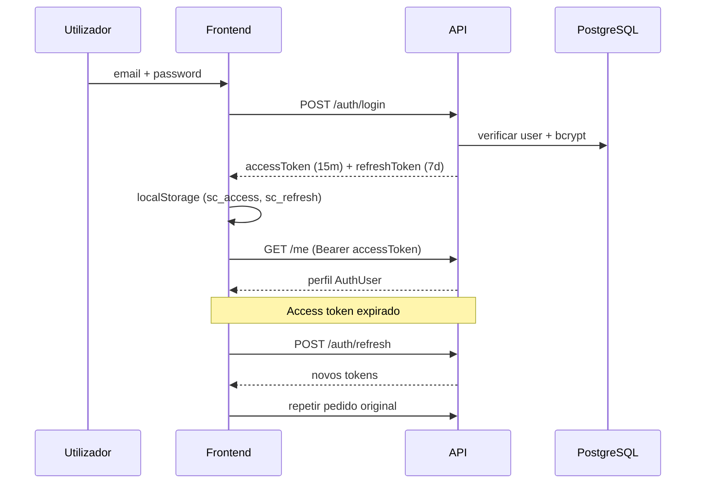
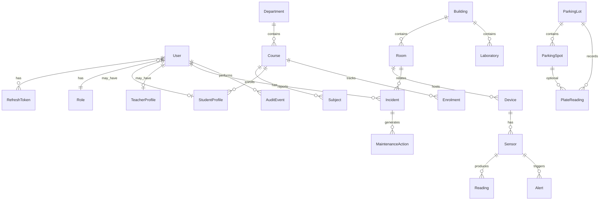

# Arquitectura do Sistema — Smart Campus Core

> **Projecto:** Smart Campus Core  
> **Instituição:** Universidade Joaquim Alberto Chissano (UJAC)  
> **Unidade curricular:** Prática Técnico-Profissional III (PTP III)  
> **Versão do documento:** 1.1  
> **Última actualização:** Agosto 2026

---

## 1. Introdução

O **Smart Campus Core** é uma plataforma integrada para gestão operacional e académica de um campus universitário. O sistema foi concebido como **monólito modular** num **monorepo npm**, permitindo que diferentes grupos da PTP III desenvolvam módulos (académico, infraestrutura, IoT, relatórios) **sem duplicar** autenticação, utilizadores, auditoria, validação ou configuração.

> A justificação completa da escolha **monólito modular vs arquitectura distribuída** está na [secção 2](#2-decisão-arquitectural-monólito-modular-vs-distribuído).

### Objectivos arquitecturais

| Objectivo | Implementação |
| --- | --- |
| Core único partilhado | Auth, users, audit, API versionada, pacotes comuns |
| Evolução incremental | Módulos marcados `available`, `partial` ou `development` |
| Tipagem ponta-a-ponta | TypeScript + DTOs partilhados + Zod |
| Integração futura IoT | Schema MQTT, dispositivos, sensores; dados demo até ligação real |
| Demonstrabilidade | Seed com utilizadores, salas, ocorrências, parque, IoT fictício |
| Deploy reproduzível | Docker Compose, Dockerfile multi-stage, GitHub Actions |

---

## 2. Decisão arquitectural: monólito modular vs distribuído

### 2.1 Decisão adoptada

| Aspecto | Escolha |
| --- | --- |
| **Arquitectura do Core** | **Monólito modular** |
| **Microserviços completos** | **Não** nesta fase do projecto |
| **Modelo de deploy** | API + Web + PostgreSQL (Docker Compose) |
| **Excepções futuras** | Serviços externos pontuais (IoT/MQTT, LPR) |

Esta decisão é **intencional** e adequada ao contexto da PTP III na UJAC: vários grupos desenvolvem módulos sobre um **núcleo único** partilhado, sem duplicar autenticação, utilizadores, auditoria ou configuração.

### 2.2 O que significa «monólito modular»

Num **monólito modular**, toda a lógica de negócio do Core corre num **único processo** (a API Express), mas o código está **organizado por módulos** com fronteiras claras:

```text
apps/api/src/modules/
├── auth/          domain · application · http
├── rooms/
├── incidents/
├── parking/
├── audit/
└── ...
```

Cada módulo expõe routers HTTP, serviços de aplicação e regras de domínio **isoladas por pasta**, mas partilham:

- a mesma base de dados (PostgreSQL);
- o mesmo middleware (auth, auditoria, correlation);
- os mesmos pacotes (`shared-types`, `validation`);
- o mesmo ciclo de deploy.

Isto **não** é um «monólito em bola de neve»: a separação por módulos permite evoluir ou extrair partes no futuro sem reescrever o sistema.

### 2.3 Comparação com arquitectura distribuída

| Critério | Monólito modular (actual) | Arquitectura distribuída (microserviços) |
| --- | --- | --- |
| **Complexidade operacional** | Baixa — um deploy, uma BD, debug simples | Alta — múltiplos serviços, rede, observabilidade |
| **Coordenação entre grupos PTP III** | Natural — um repo, contratos partilhados | Difícil — contratos entre serviços, versionamento |
| **Tempo até demonstração** | Curto — fluxo transversal já funcional | Longo — infraestrutura antes das features |
| **Auth, audit, users** | Partilhados no Core | Exigem serviço de identidade, API gateway, etc. |
| **Consistência de dados** | Transacções ACID na mesma BD | Eventual consistency, sagas, mensageria |
| **Escala horizontal** | Suficiente para campus universitário | Justificada só com carga real elevada |
| **Custo de manutenção** | Baixo para equipa académica | Alto — DevOps, monitorização, tracing |

### 2.4 Porque não microserviços nesta fase

1. **Objectivo do projecto** — Entregar um Core demonstrável onde grupos integrem módulos; não operar um datacenter.
2. **Maturidade dos módulos** — Muitos estão `partial` ou `development`; dividir serviços agora multiplicaria trabalho sem valor.
3. **Fluxo transversal** — Login → salas → ocorrências → auditoria depende de transacções rápidas na mesma BD.
4. **Equipa e prazo** — Microserviços exigem API gateway, service discovery, logs centralizados e CI por serviço.
5. **Demonstração académica** — `docker compose up` com 3 contentores é suficiente para apresentar o sistema.

### 2.5 Evolução híbrida (quando fizer sentido)

A arquitectura **não exclui** serviços externos no futuro. O padrão recomendado é **monólito modular + integrações distribuídas** apenas onde há pressão real:



| Componente | Manter no monólito | Extrair para serviço separado |
| --- | --- | --- |
| Auth, users, roles | Sim | Não (a menos que multi-campus) |
| Salas, ocorrências, auditoria | Sim | Não |
| Dashboard, relatórios | Sim | Não na fase actual |
| Ingestão MQTT / sensores | Interface na API | **Sim** — volume e protocolo distinto |
| Processamento LPR (câmaras) | Endpoint na API | **Talvez** — se carga ou ML separado |

**Critérios para extrair um módulo:**

- protocolo ou runtime diferente (ex.: MQTT, Python/ML);
- necessidade de escalar independentemente;
- equipa ou ciclo de deploy separado;
- falhas isoladas não devem derrubar o Core.

Até lá, campos como `Device.mqttTopic` e endpoints `/parking/readings` preparam a integração **sem** dividir o deploy.

### 2.6 Implicações práticas para developers

| Regra | Acção |
| --- | --- |
| Novo módulo | Criar pasta em `apps/api/src/modules/<nome>/` com `http`, `application`, `domain` |
| Contratos | DTOs em `@smart-campus/shared-types`; validação em `@smart-campus/validation` |
| BD | Migração Prisma no monólito; evitar BD por serviço |
| Comunicação entre módulos | Chamadas internas a serviços, **não** HTTP entre módulos do Core |
| Integração externa | REST ou mensageria **para dentro** da API; a API expõe `/api/v1` ao frontend |
| Estado do módulo | Actualizar `campusModules` com `available` \| `partial` \| `development` |

### 2.7 Resumo da decisão

> O Smart Campus Core adopta **monólito modular** como arquitectura principal. Microserviços completos **não** são adoptados nesta fase. A evolução prevista é **híbrida**: Core monolítico estável + serviços externos pontuais (IoT/MQTT, eventualmente LPR) quando houver requisito técnico ou operacional claro.

---

## 3. Visão geral do sistema



### Portas e URLs (desenvolvimento)

| Serviço | URL | Descrição |
| --- | --- | --- |
| Frontend (Vite) | http://localhost:5173 | SPA React |
| API REST | http://localhost:4100/api/v1 | Backend Express |
| Health check | http://localhost:4100/health | Estado da API |
| Swagger UI | http://localhost:4100/api/docs | Documentação OpenAPI |
| PostgreSQL | localhost:5432 | Base de dados |

---

## 4. Stack tecnológico

### 4.1 Linguagens

| Linguagem | Uso |
| --- | --- |
| **TypeScript 5.8** | Backend, frontend, pacotes partilhados, seed, testes |
| **SQL** | Migrações Prisma (geradas) |
| **YAML** | OpenAPI, Docker Compose, GitHub Actions, templates de issues |
| **CSS** | Estilos globais (`index.css`) + utilitários Tailwind |
| **HTML** | Entry point Vite (`index.html`) |
| **Markdown** | Documentação do projecto |

### 4.2 Runtime e ferramentas

| Tecnologia | Versão | Função |
| --- | --- | --- |
| **Node.js** | ≥ 20 (recomendado 22) | Runtime do backend e build |
| **npm workspaces** | 10+ | Monorepo e gestão de dependências |
| **tsx** | 4.x | Execução TypeScript em dev (API + seed) |
| **Vite** | 6.x | Bundler e dev server do frontend |
| **Vitest** | 3.x | Testes unitários e de integração |
| **Supertest** | 7.x | Testes HTTP da API |
| **Prisma** | 6.5 | ORM, migrações, client gerado |
| **Docker / Compose** | — | PostgreSQL e deploy completo |
| **Nginx** | Alpine | Servir SPA em produção |
| **GitHub Actions** | — | CI: build, migrate, seed, testes |

### 4.3 Backend (`apps/api`)

| Biblioteca | Função |
| --- | --- |
| **Express 4** | Servidor HTTP e routing |
| **jsonwebtoken** | Access + refresh tokens JWT |
| **bcryptjs** | Hash de passwords |
| **Zod** (via `@smart-campus/validation`) | Validação de payloads |
| **helmet** | Cabeçalhos de segurança HTTP |
| **cors** | Política CORS configurável |
| **express-rate-limit** | Limitação de pedidos |
| **swagger-ui-express + yaml** | Documentação interactiva |
| **uuid** | Identificadores de correlação |

### 4.4 Frontend (`apps/web`)

| Biblioteca | Função |
| --- | --- |
| **React 19** | UI declarativa |
| **React Router 7** | Routing SPA e rotas protegidas |
| **Tailwind CSS 3** | Design system utilitário |
| **PostCSS + Autoprefixer** | Processamento CSS |
| **Fraunces + Manrope** | Tipografia académica (Google Fonts) |
| **@testing-library/react** | Testes de componentes |

### 4.5 Base de dados

| Tecnologia | Função |
| --- | --- |
| **PostgreSQL 16** | SGBD relacional principal |
| **Prisma Client** | Acesso tipado à BD |
| **Prisma Migrate** | Versionamento de schema |

---

## 5. Estrutura do monorepo

```text
UniversityCampusSystem/
├── apps/
│   ├── api/                    # Backend Express + TypeScript
│   │   └── src/
│   │       ├── app.ts          # Composição Express
│   │       ├── index.ts        # Bootstrap do servidor
│   │       ├── config/         # Variáveis de ambiente
│   │       ├── lib/            # Logger, Prisma, erros
│   │       ├── middleware/     # Auth, correlation, errors
│   │       └── modules/        # Módulos de domínio
│   └── web/                    # Frontend React + Vite
│       └── src/
│           ├── pages/          # Uma página por módulo/rota
│           ├── components/     # UI reutilizável
│           ├── layouts/        # AppLayout (shell + nav)
│           ├── hooks/          # Data fetching (ex.: Campus Ops)
│           └── lib/            # Auth, dados demo IoT
├── packages/
│   ├── shared-types/           # DTOs, enums, catálogo de módulos
│   ├── validation/             # Schemas Zod partilhados
│   └── api-client/             # Cliente HTTP tipado com refresh
├── prisma/
│   ├── schema.prisma           # Modelo de dados
│   ├── migrations/             # Migrações SQL versionadas
│   └── seed.ts                 # Dados de demonstração
├── docs/                       # Documentação técnica
├── .github/workflows/          # CI/CD
├── docker-compose.yml
├── Dockerfile                  # Multi-stage: api + web
├── package.json                # Workspaces raiz
└── .env.example
```

### Workspaces npm

| Pacote | Nome npm | Descrição |
| --- | --- | --- |
| Raiz | `smart-campus` | Scripts globais, Prisma, dependências comuns |
| API | `@smart-campus/api` | Servidor REST |
| Web | `@smart-campus/web` | Aplicação React |
| Tipos | `@smart-campus/shared-types` | Contratos partilhados |
| Validação | `@smart-campus/validation` | Schemas Zod |
| Cliente | `@smart-campus/api-client` | SDK HTTP para o frontend |

**Ordem de build:** `shared-types` → `validation` → `api-client` → `api` → `web`

---

## 6. Arquitectura em camadas

O backend segue uma separação inspirada em **Clean Architecture / DDD light**:

```text
┌─────────────────────────────────────────────────────────┐
│  Apresentação — apps/web (React)                        │
│  Páginas, componentes, hooks, routing                   │
└───────────────────────────┬─────────────────────────────┘
                            │ HTTP/JSON + JWT
┌───────────────────────────▼─────────────────────────────┐
│  Interface HTTP — apps/api/modules/*/http               │
│  Routers Express, parsing, authz, serialização            │
└───────────────────────────┬─────────────────────────────┘
                            │
┌───────────────────────────▼─────────────────────────────┐
│  Aplicação — apps/api/modules/*/application             │
│  Casos de uso, orquestração, transacções                │
└───────────────────────────┬─────────────────────────────┘
                            │
┌───────────────────────────▼─────────────────────────────┐
│  Domínio — apps/api/modules/*/domain                    │
│  Regras de negócio (ex.: matrículas MZ, validações)     │
└───────────────────────────┬─────────────────────────────┘
                            │
┌───────────────────────────▼─────────────────────────────┐
│  Persistência — Prisma + PostgreSQL                     │
└─────────────────────────────────────────────────────────┘
```

| Camada | Responsabilidade | Localização |
| --- | --- | --- |
| **Apresentação** | UI, UX, estado local, responsividade | `apps/web` |
| **HTTP / API** | Rotas REST, middleware, contratos | `apps/api/src/modules/*/http` |
| **Aplicação** | Serviços, casos de uso | `apps/api/src/modules/*/application` |
| **Domínio** | Invariantes e regras puras | `apps/api/src/modules/*/domain` |
| **Infraestrutura** | Prisma, Docker, CI, logs | `prisma/`, `Dockerfile`, `.github/` |
| **Contratos partilhados** | DTOs, validação, cliente | `packages/*` |

---

## 7. Backend — módulos e endpoints

### 7.1 Middleware global

Executado em todas as rotas (excepto onde indicado):

1. **helmet** — cabeçalhos de segurança  
2. **cors** — origens permitidas (`CORS_ORIGIN`)  
3. **express.json** — parse JSON (limite 100 KB)  
4. **correlationId** — ID único por pedido (`x-correlation-id` ou gerado)  
5. **rateLimit** — 200 pedidos / 15 min (configurável)  
6. **errorHandler** — respostas de erro normalizadas  

### 7.2 Módulos implementados

| Módulo | Router | Serviço | Estado |
| --- | --- | --- | --- |
| **Auth** | `/auth/*` | `authService` | Completo |
| **Users** | `/users`, `/me` | inline / Prisma | Completo |
| **Rooms** | `/rooms` | `roomService` | Completo |
| **Incidents** | `/incidents` | `incidentService` | Completo |
| **Audit** | `/audit-events` | `auditService` | Completo |
| **Dashboard** | `/dashboard` | `dashboardService` | Completo |
| **Devices** | `/devices`, `/alerts` | inline / Prisma | Parcial |
| **Parking** | `/parking/*` | `parkingService` | Completo |

### 7.3 Endpoints REST (`/api/v1`)

#### Autenticação (sem JWT excepto logout)

| Método | Rota | Descrição |
| --- | --- | --- |
| POST | `/auth/login` | Login (email + password) |
| POST | `/auth/refresh` | Renovar access token |
| POST | `/auth/logout` | Revogar refresh token |

#### Core

| Método | Rota | Auth | Roles |
| --- | --- | --- | --- |
| GET | `/me` | Sim | Todos |
| GET | `/users` | Sim | ADMIN, COORDINATOR |
| POST | `/users` | Sim | ADMIN |
| GET | `/rooms` | Sim | Todos |
| POST | `/rooms` | Sim | COORDINATOR, ADMIN |
| GET | `/rooms/:id` | Sim | Todos |
| GET | `/incidents` | Sim | Todos |
| POST | `/incidents` | Sim | Todos |
| PATCH | `/incidents/:id/status` | Sim | TECHNICIAN, COORDINATOR, ADMIN |
| GET | `/audit-events` | Sim | ADMIN, COORDINATOR |
| GET | `/dashboard` | Sim | Todos |
| GET | `/devices` | Sim | Todos |
| GET | `/alerts` | Sim | Todos |
| GET | `/buildings` | Sim | Todos |

#### Estacionamento

| Método | Rota | Auth | Roles |
| --- | --- | --- | --- |
| GET | `/parking/overview` | Sim | Todos |
| GET | `/parking/readings` | Sim | Todos |
| POST | `/parking/readings` | Sim | TECHNICIAN, COORDINATOR, ADMIN |
| PATCH | `/parking/spots/:id` | Sim | TECHNICIAN, COORDINATOR, ADMIN |

### 7.4 Formato de resposta

**Sucesso:**
```json
{
  "data": { ... },
  "meta": {
    "correlationId": "uuid",
    "page": 1,
    "pageSize": 20,
    "total": 100
  }
}
```

**Erro:**
```json
{
  "code": "VALIDATION_ERROR",
  "message": "Dados inválidos",
  "details": [],
  "correlationId": "uuid"
}
```

---

## 8. Autenticação e autorização

### 8.1 Fluxo JWT



| Token | Expiração default | Armazenamento |
| --- | --- | --- |
| Access | 15 minutos (`JWT_ACCESS_EXPIRES_IN`) | `localStorage` → `sc_access` |
| Refresh | 7 dias (`JWT_REFRESH_EXPIRES_IN`) | `localStorage` → `sc_refresh` + hash na BD |

O refresh token é guardado na tabela `RefreshToken` com hash; revogação no logout.

### 8.2 Roles (RBAC)

| Role | Código | Perfil |
| --- | --- | --- |
| Estudante | `STUDENT` | Consulta, criar ocorrências |
| Docente | `TEACHER` | Consulta lectiva |
| Técnico | `TECHNICIAN` | Ocorrências, IoT, parque |
| Coordenador | `COORDINATOR` | Gestão operacional, auditoria |
| Administrador | `ADMIN` | Acesso total |

Middleware: `authenticate` (JWT) + `authorize(...roles)` (RBAC).  
Matriz detalhada: [authorization-matrix.md](./authorization-matrix.md).

---

## 9. Frontend — estrutura e rotas

### 9.1 Arquitectura SPA

```text
main.tsx
  └── AuthProvider (React Context)
        └── BrowserRouter
              └── App.tsx (Routes)
                    ├── /login → LoginPage
                    └── / (Protected + AppLayout)
                          ├── /ops → CampusOpsPage (home)
                          ├── /dashboard → DashboardPage
                          ├── /users, /rooms, /incidents, ...
                          └── placeholders → ModulePlaceholderPage
```

- **Layout:** sidebar fixa (desktop) / drawer (mobile), header sticky, safe-area  
- **Protecção:** componente `Protected` redirecciona para `/login`  
- **API:** hook `useAuth()` expõe `api` (cliente tipado) e `user`  

### 9.2 Páginas por estado

| Estado | Páginas |
| --- | --- |
| **available** | Ops, Dashboard, Users, Rooms, Incidents, Parking, Audit |
| **partial** | Academic hub, Campus hub, Buildings, IoT, Devices, Alerts, Admin, Maintenance |
| **development** | Departments, Courses, Subjects, Enrolments, Assessments, Schedules, Labs, Equipment, Sensors, Readings, Notifications, Reports |

O catálogo `campusModules` em `@smart-campus/shared-types` define label, path, status e `requiredRoles` para cada módulo.

### 9.3 Componentes principais

| Área | Componentes | Descrição |
| --- | --- | --- |
| **Campus Ops** | `CampusMap`, `BuildingDetailPanel`, `MetricFilters`, `OccupancyPulse`, `WeeklyPatternChart`, `LiveTicker` | Centro de operações com mapa SVG e métricas demo |
| **IoT** | `IotDeviceCard`, `iotDemo.ts` | Hub IoT com fluxo Sensor→ESP32→MQTT→API simulado |
| **Estacionamento** | `ParkingPage` | Mapa de vagas, LPR, matrículas moçambicanas |
| **Core UI** | `BrandMark`, `PageIntro`, `ModuleStatusBadge`, `ModulePlaceholder` | Identidade visual e placeholders |

### 9.4 Design system

- **Cores:** paleta `campus-*` (navy, teal, brass, paper)  
- **Fontes:** Fraunces (display) + Manrope (UI)  
- **CSS:** classes utilitárias `.surface`, `.btn-primary`, `.field-input` em CSS puro + Tailwind  
- **Responsivo:** drawer mobile, scroll horizontal em tabelas/mapas, `100dvh`, safe-area  

---

## 10. Modelo de dados (PostgreSQL)

### 10.1 Diagrama conceptual



### 10.2 Domínios de dados

| Domínio | Modelos Prisma | Notas |
| --- | --- | --- |
| **Identidade** | `Role`, `User`, `RefreshToken` | 5 roles demo no seed |
| **Académico** | `Department`, `Course`, `Subject`, `StudentProfile`, `TeacherProfile`, `Enrolment` | Schema pronto; UI parcial |
| **Campus físico** | `Building`, `Room`, `Laboratory`, `Equipment` | Salas e edifícios activos |
| **Manutenção** | `Incident`, `MaintenanceAction` | Fluxo transversal completo |
| **IoT** | `Device`, `Sensor`, `Reading`, `Alert` | Leituras/alertas marcados `isDemo` |
| **Notificações** | `Notification` | Preparado, UI em desenvolvimento |
| **Auditoria** | `AuditEvent` | CorrelationId, metadata JSON |
| **Estacionamento** | `ParkingLot`, `ParkingSpot`, `PlateReading` | LPR + vagas com matrículas MZ |

### 10.3 Enums principais

- `RoleCode`: STUDENT, TEACHER, TECHNICIAN, COORDINATOR, ADMIN  
- `IncidentStatus`: OPEN, IN_PROGRESS, RESOLVED, CLOSED  
- `RoomStatus`: AVAILABLE, OCCUPIED, MAINTENANCE, RESERVED  
- `DeviceStatus`: ONLINE, OFFLINE, MAINTENANCE, UNKNOWN  
- `ParkingSpotStatus`: FREE, OCCUPIED, RESERVED, OUT_OF_SERVICE  
- `PlateDirection`: IN, OUT  

### 10.4 Regras de domínio — matrículas moçambicanas

Implementadas em `packages/validation/src/mozambiquePlate.ts`:

| Formato | Exemplo | Regra |
| --- | --- | --- |
| MP / MC moderno | `AIT 954 MC`, `AMH 722 MP` | `AXX 123 MP\|MC` — **sempre começa por A** |
| Legado | `MLY 72 22` | `AAA 12 34` |

Validação na API (Zod) e testes em `mozambiquePlate.test.ts`.

---

## 11. Pacotes partilhados

### 11.1 `@smart-campus/shared-types`

- DTOs: `AuthUser`, `RoomDto`, `IncidentDto`, `DashboardSummary`, `ParkingLotOverview`, etc.  
- Tipos de API: `ApiSuccess<T>`, `ApiError`  
- Catálogo: `campusModules[]` — fonte única para navegação frontend  

### 11.2 `@smart-campus/validation`

Schemas Zod reutilizáveis:

- `loginSchema`, `refreshSchema`, `createUserSchema`  
- `createRoomSchema`, `createIncidentSchema`, `updateIncidentStatusSchema`  
- `createPlateReadingSchema`, `updateParkingSpotSchema`  
- `mozambiquePlateSchema` (transform + refine)  

### 11.3 `@smart-campus/api-client`

- `createApiClient(baseUrl, tokenStore)`  
- Refresh automático em 401  
- Métodos tipados: `login`, `me`, `rooms`, `incidents`, `parkingOverview`, etc.  
- Erro tipado: `ApiClientError` com `code`, `correlationId`, `status`  

---

## 12. Fluxos de negócio

### 12.1 Fluxo transversal (demonstração PTP III)

```text
Login → GET /me → listar salas → criar ocorrência → alterar estado → consultar auditoria
```

Roles envolvidas: qualquer utilizador cria; técnico/coordenador/admin tratam.

### 12.2 Fluxo Campus Ops

```text
Dashboard API + Buildings API + Devices API
        ↓
useCampusOpsData (hook)
        ↓
CampusMap (SVG) + BuildingDetailPanel + WeeklyPatternChart
```

Métricas ambientais (temperatura, CO₂, humidade, ocupação) são **parcialmente demo** até integração MQTT.

### 12.3 Fluxo IoT (actual e futuro)

**Actual (demo):**
```text
Frontend (iotDemo.ts) → dados estáticos/simulados → UI animada
API /devices → dispositivos reais do seed
```

**Futuro (planeado):**
```text
Sensor → ESP32 → Wi-Fi → MQTT Broker → Serviço IoT → API → PostgreSQL → Dashboard → Alertas
```

### 12.4 Fluxo estacionamento

```text
Câmara LPR / sensor de vaga
        ↓
POST /parking/readings (plate, direction, confidence, photoUrl)
        ↓
parkingService: validar matrícula MZ → actualizar vaga → registar leitura
        ↓
GET /parking/overview + GET /parking/readings → ParkingPage
```

Entrada (`IN`): atribui matrícula a vaga livre. Saída (`OUT`): liberta vaga.

---

## 13. Infraestrutura e deploy

### 13.1 Docker Compose

| Serviço | Imagem / build | Porta |
| --- | --- | --- |
| `db` | postgres:16-alpine | 5432 |
| `api` | Dockerfile target `api` | 4100 |
| `web` | Dockerfile target `web` (nginx) | 5173→80 |

Comando: `docker compose up --build`

**Deploy gratuito (recomendado para demo online):** Neon (PostgreSQL) + Render (API + static web). Ver [`deploy-gratuito.md`](deploy-gratuito.md) e [`render.yaml`](../render.yaml).

### 13.2 Dockerfile (multi-stage)

1. **base** — `npm install` com workspaces  
2. **api-build** — compilar pacotes + API + `prisma generate`  
3. **api** — runtime Node 22; `prisma migrate deploy` + `node dist/index.js`  
4. **web-build** — compilar frontend com `VITE_API_BASE_URL`  
5. **web** — nginx Alpine servindo `/dist` com fallback SPA  

### 13.3 CI (GitHub Actions)

Pipeline `build-test` em push/PR para `main`:

1. Checkout + Node 22  
2. PostgreSQL service container  
3. `npm install` → `prisma generate` → `migrate deploy` → `seed`  
4. Build pacotes partilhados  
5. `npm test` (API + Web)  

### 13.4 Variáveis de ambiente

| Variável | Descrição |
| --- | --- |
| `DATABASE_URL` | Connection string PostgreSQL |
| `API_PORT` / `API_HOST` | Binding do servidor (default 4100) |
| `CORS_ORIGIN` | Origens permitidas (ex.: http://localhost:5173) |
| `JWT_ACCESS_SECRET` / `JWT_REFRESH_SECRET` | Segredos JWT (≥ 32 chars) |
| `JWT_ACCESS_EXPIRES_IN` / `JWT_REFRESH_EXPIRES_IN` | Expiração dos tokens |
| `RATE_LIMIT_WINDOW_MS` / `RATE_LIMIT_MAX` | Rate limiting |
| `VITE_API_BASE_URL` | URL da API no frontend |
| `LOG_LEVEL` | Nível de logging |

Ver `.env.example` para valores de desenvolvimento.

---

## 14. Testes

| Tipo | Ferramenta | Localização |
| --- | --- | --- |
| Unitário (domínio) | Vitest | `apps/api/src/modules/*/domain/*.test.ts` |
| Integração (auth) | Vitest + Supertest | `apps/api/src/modules/auth/http/*.test.ts` |
| Frontend | Vitest + Testing Library | `apps/web/src/App.test.tsx` |

Comandos:
```bash
npm test              # todos
npm run test:api      # só API
npm run test:web      # só frontend
```

---

## 15. Segurança

| Medida | Implementação |
| --- | --- |
| Passwords | bcrypt (cost 12) |
| Tokens | JWT assinado; refresh com hash na BD |
| HTTP | Helmet, CORS restrito, rate limit |
| Authz | RBAC no backend (nunca confiar só no frontend) |
| Erros | Sem stack traces, passwords ou tokens nas respostas |
| Auditoria | `AuditEvent` com correlationId, IP, user-agent |
| Demo | Credenciais e dados claramente fictícios |

---

## 16. Documentação relacionada

| Documento | Conteúdo |
| --- | --- |
| [README.md](../README.md) | Instalação rápida e credenciais demo |
| [manual-construcao-core.md](./manual-construcao-core.md) | Manual passo a passo para construir o Core completo |
| [manual-apis-core.md](./manual-apis-core.md) | Catálogo das APIs, criação e testes (Swagger/Postman/curl) |
| [api-conventions.md](./api-conventions.md) | Convenções REST |
| [authorization-matrix.md](./authorization-matrix.md) | Matriz de permissões |
| [integration-guide.md](./integration-guide.md) | Como integrar novos módulos |
| [openapi.yaml](./openapi.yaml) | Especificação OpenAPI 3.0 |
| [CONTRIBUTING.md](../CONTRIBUTING.md) | Guia de contribuição |

---

## 17. Limitações actuais e evolução

| Área | Estado actual | Próximo passo |
| --- | --- | --- |
| MQTT / IoT real | Dados demo + schema preparado | Broker MQTT + serviço ingestão |
| Módulos académicos | Schema + placeholders | CRUD completo + UI |
| Notificações | Modelo na BD | WebSocket ou polling + UI |
| Relatórios | Placeholder | Agregações e export PDF/CSV |
| MQTT tópicos | Campo `mqttTopic` em Device | Subscrição e persistência de readings |
| Produção | Docker funcional | Secrets management, HTTPS, backups BD |

---

## 18. Resumo executivo

O **Smart Campus Core** é um **monólito modular** num monorepo TypeScript (ver secção 2):

- **Frontend:** React 19 + Vite + Tailwind (SPA responsiva)  
- **Backend:** Express + Prisma + PostgreSQL (API REST versionada)  
- **Partilhado:** tipos, validação Zod e cliente HTTP  
- **Auth:** JWT access/refresh com RBAC de 5 roles  
- **Módulos activos:** auth, users, rooms, incidents, audit, dashboard, parking, ops/IoT parcial  
- **Infra:** Docker Compose, CI GitHub Actions, OpenAPI/Swagger  

A arquitectura privilegia **evolução modular** para equipas PTP III, mantendo um **núcleo único** estável. Serviços externos (IoT/MQTT, LPR) só serão adoptados quando houver requisito técnico claro, sem migrar para microserviços completos.
