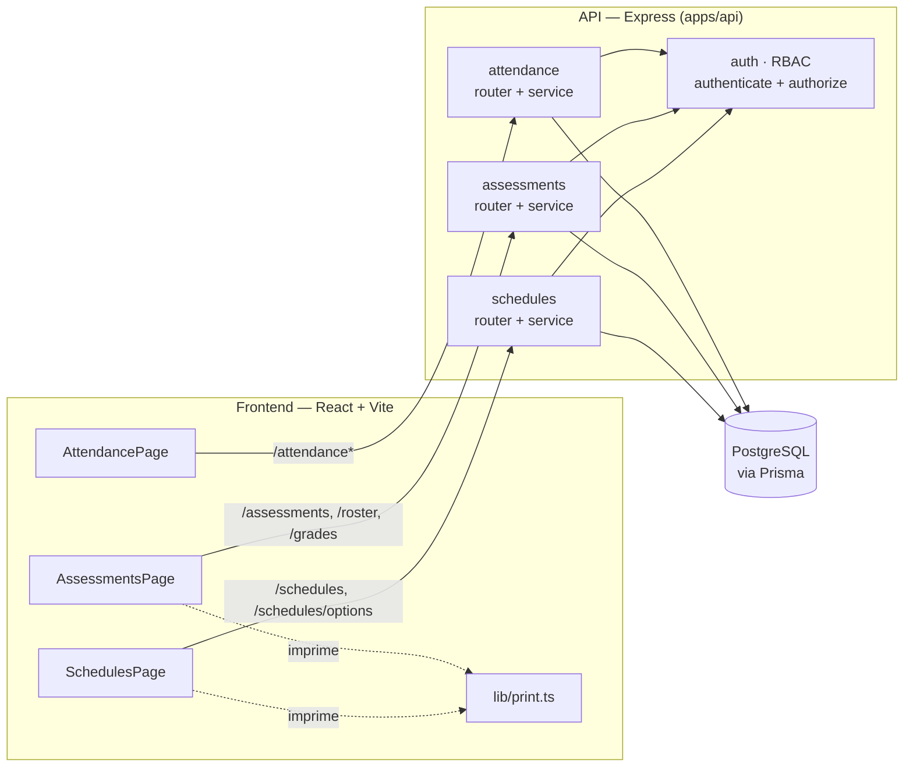
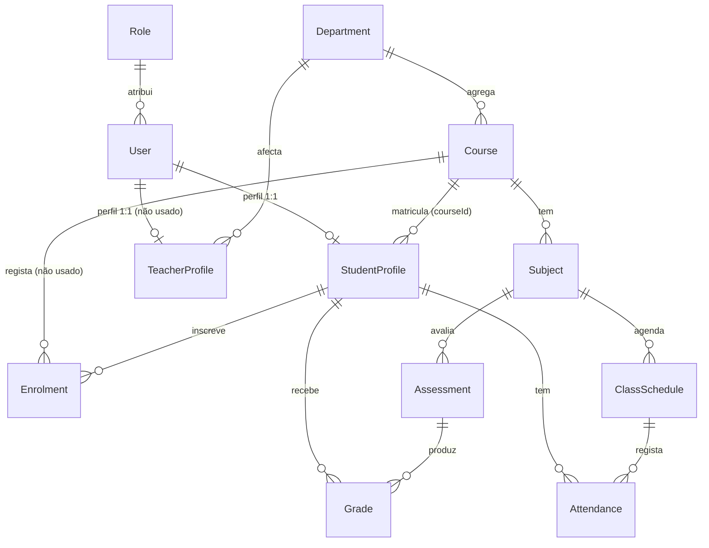
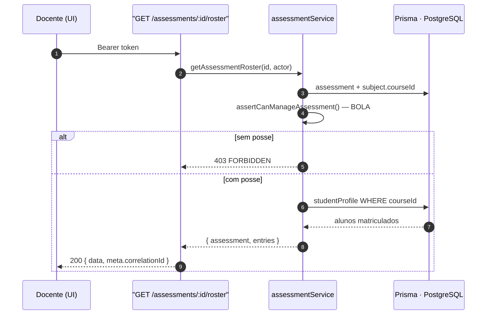
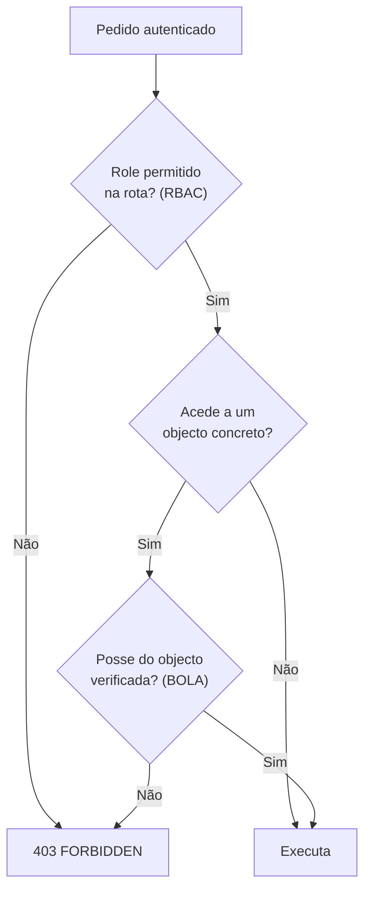

# Consumo de Estudantes, Docentes e Cursos — com critério BOLA


> **Documento de referência** do Grupo Académico (**G3**) — módulos **Horários**, **Avaliações/Notas** e **Assiduidade**.
> Descreve **como** estes módulos obtêm **estudantes**, **docentes**, **cursos** e **alunos matriculados**, e **como** aplicam o critério **BOLA** (*Broken Object Level Authorization*) — a verificação de **posse do objecto** para além do simples papel (RBAC).

<p align="center">
  <em>Contrato: <code>03-financeiro-avaliacoes-horarios.md</code> · Código: <code>apps/api/src/modules/{schedules,assessments,attendance,users}</code> · Frontend: <code>apps/web/src/pages</code></em>
</p>

---

## Sumário

1. [Resumo executivo](#1-resumo-executivo)
2. [Arquitectura do fluxo de dados](#2-arquitectura-do-fluxo-de-dados)
3. [Modelo de dados](#3-modelo-de-dados)
4. [Onde vêm os dados (Prisma, sem serviço externo)](#4-onde-vêm-os-dados-prisma-sem-serviço-externo)
5. [Como cada módulo consome os dados](#5-como-cada-módulo-consome-os-dados)
6. [Critério BOLA em detalhe](#6-critério-bola-em-detalhe)
7. [Matriz de endpoints × roles](#7-matriz-de-endpoints--roles)
8. [Consumo no frontend](#8-consumo-no-frontend)
9. [Impressão (pauta · horário · notas)](#9-impressão-pauta--horário--notas)
10. [Evidência: testes e verificação ao vivo](#10-evidência-testes-e-verificação-ao-vivo)
11. [Lacunas e riscos](#11-lacunas-e-riscos)
12. [Referências de código](#12-referências-de-código)

---

## 1. Resumo executivo

Para **lançar notas** e **criar horários** é necessário ter docentes, cursos, disciplinas, salas e alunos matriculados. Este documento mapeia **cada fonte de dados** e **quem pode aceder a quê**.

| Necessidade | Fonte no sistema | Endpoint que a expõe |
|---|---|---|
| **Docentes** para atribuir a uma sessão | `User` com `role.code = 'TEACHER'` e `isActive = true` | `GET /schedules/options` → `teachers` |
| **Cursos** e **disciplinas** | `Course` / `Subject` | `GET /schedules/options` → `courses`, `subjects` · `GET /assessments/options` → `subjects` |
| **Salas** | `Room` | `GET /schedules/options` → `rooms` |
| **Estudantes matriculados** num curso (lançar notas) | `StudentProfile.courseId` do curso da disciplina | `GET /assessments/:id/roster` → `entries` |
| **Estudantes matriculados** numa sessão (assiduidade) | `StudentProfile.courseId` do curso da sessão | `GET /attendance/sessions/:scheduleId` → `entries` |

> **Regra de ouro do BOLA**
> Os filtros opcionais (`?studentId`, `?courseId`, …) **apenas restringem** o resultado — **nunca ampliam** o acesso. A posse do objecto é sempre reconfirmada no servidor.

---

## 2. Arquitectura do fluxo de dados



Todos os módulos convergem em três dependências: **RBAC** (`authenticate` + `authorize`), **BOLA** (regras de posse nos *services*) e **Prisma/PostgreSQL** (fonte única de verdade).

---

## 3. Modelo de dados



**Leitura do diagrama:** as tabelas a **cheio** são usadas pelo código; as anotadas *“não usado”* (`TeacherProfile`, `Enrolment`) existem no schema mas estão **por adoptar** — a matrícula é hoje o campo `StudentProfile.courseId` e os docentes vêm de `User.role`.

---

## 4. Onde vêm os dados (Prisma, sem serviço externo)

Neste monorepo **não existe** módulo/serviço externo de “estudantes” ou “docentes”, nem chamadas HTTP a serviços Core. As entidades são resolvidas **localmente via Prisma**:

| Conceito | Implementação |
|---|---|
| **Docente** | `User` cujo `Role.code === 'TEACHER'` (não se usa `TeacherProfile`) |
| **Estudante** | `StudentProfile` (1‑para‑1 com `User` via `userId`), com `studentNumber` e `courseId` |
| **Matrícula** | campo `StudentProfile.courseId` (o modelo `Enrolment` existe, mas não é usado) |

**Referências no código**

- `apps/api/src/modules/schedules/application/scheduleService.ts:146-159` — cursos, disciplinas, **docentes** (`User` role `TEACHER`), salas
- `apps/api/src/modules/assessments/application/assessmentService.ts:195-199` — **estudantes do curso** da disciplina
- `apps/api/src/modules/attendance/application/attendanceService.ts:165-169` — **estudantes do curso** da sessão

### 4.1 Inventário de modelos

| Modelo | Usado | Papel |
|---|:---:|---|
| `User` / `Role` | ✅ | Identidade e papel (`STUDENT`, `TEACHER`, `COORDINATOR`, `ADMIN`, `TECHNICIAN`) |
| `StudentProfile` | ✅ | Perfil do estudante (`studentNumber`, `courseId`) — base do roster e do scoping do aluno |
| `Course` | ✅ | Curso; agrega `subjects`, `students`, `enrolments`, `schedules` |
| `Subject` | ✅ | Disciplina de um curso; liga avaliações e horários |
| `ClassSchedule` | ✅ | Sessão (`subjectId`, `courseId`, `teacherId`, `roomId`, `startsAt`, `endsAt`) |
| `Assessment` / `Grade` | ✅ | Avaliação (do docente) e nota (por estudante) |
| `Attendance` | ✅ | Assiduidade por sessão e estudante |
| `TeacherProfile` | ❌ | Existe no schema; docentes vêm de `User.role` |
| `Enrolment` | ❌ | Existe no schema; matrícula é `StudentProfile.courseId` |

---

## 5. Como cada módulo consome os dados

### 5.1 Horários — `GET /schedules/options`

Dados de referência do formulário de gestão (exclusivo de `COORDINATOR`/`ADMIN`):

```ts
// scheduleService.ts:143-167
const [courses, subjects, teachers, rooms] = await Promise.all([
  prisma.course.findMany({ orderBy: { code: 'asc' }, select: { id, code, name } }),
  prisma.subject.findMany({ orderBy: { code: 'asc' }, select: { id, code, name, courseId } }),
  prisma.user.findMany({ where: { isActive: true, role: { code: 'TEACHER' } },
                         orderBy: { fullName: 'asc' }, select: { id, fullName } }),
  prisma.room.findMany({ orderBy: { code: 'asc' }, select: { id, code, name } }),
]);
```

A UI filtra as disciplinas pelo curso escolhido (`SchedulesPage.tsx:138`) e, ao gravar, `validateScheduleRefs` reconfirma no servidor **subject**, **course**, **teacher** (`TEACHER_ROLE_MISMATCH`) e **room** (`scheduleService.ts:169-192`).

### 5.2 Avaliações — `GET /assessments/:id/roster`

A pauta são **os estudantes matriculados no curso da disciplina**:

```ts
// assessmentService.ts:186-218
assertStaff(actor);
const assessment = await prisma.assessment.findUnique({ where: { id }, include: { subject: … } });
assertCanManageAssessment(assessment, actor);              // ← BOLA
const students = await prisma.studentProfile.findMany({
  where: { courseId: assessment.subject.courseId },        // ← matriculados no curso
  include: { user: { select: { fullName: true } } },
  orderBy: { studentNumber: 'asc' },
});
```



### 5.3 Assiduidade — `GET/POST /attendance/sessions/:scheduleId`

A pauta de presenças são **os estudantes do curso da sessão** e o registo só aceita esses alunos:

```ts
// attendanceService.ts:161-217
const students = await prisma.studentProfile.findMany({ where: { courseId: schedule.courseId }, … });
…
const foreign = students.filter((s) => s.courseId && s.courseId !== schedule.courseId);
if (foreign.length > 0) throw conflict('STUDENT_COURSE_MISMATCH', …);
```

---

## 6. Critério BOLA em detalhe



### 6.1 Gestão de avaliações — posse do docente dono
`assessmentService.ts:55-59`

- `ADMIN` / `COORDINATOR` → qualquer avaliação
- `TEACHER` → **apenas** as avaliações que criou (`assessment.createdById === actor.id`)
- caso contrário → **403 FORBIDDEN**

Aplicado em `getAssessmentRoster`, `getAssessment`, `updateAssessment`, `listAssessmentGrades`, `upsertGrades`.

### 6.2 Dados de um estudante — notas e finais
`assessmentService.ts:67-89`

- `STUDENT` → **apenas o próprio** (`profile.userId === actor.id`)
- `TEACHER` → apenas estudantes **cujas notas já lançou** (relação académica)
- `COORDINATOR` / `ADMIN` → qualquer estudante

Aplicado em `listStudentGrades`, `getFinalGrades` e, indirectamente, `listMyGrades` / `listMyFinalGrades`.

### 6.3 Horários — scoping por papel + `?studentId`
`scheduleService.ts:94-136`

- `STUDENT` → horários **do próprio curso**; `?studentId` de outro estudante → **403**
- `TEACHER` → sessões **em que é docente** (`teacherId = actor.id`)
- `COORDINATOR` / `ADMIN` → todos; `?studentId` resolve `StudentProfile → courseId` e restringe por curso

### 6.4 Assiduidade — posse da sessão
`attendanceService.ts:74-102, 142-155`

- `STUDENT` → só os próprios registos; `?studentId` de outro → **403**
- `TEACHER` → apenas sessões que lecciona; registar numa sessão de outro docente → **403**
- ao registar, só aceita alunos **do curso da sessão** (senão `STUDENT_COURSE_MISMATCH`)

### 6.5 Escrita de horários
`scheduleService.ts:71-75` — `POST/PATCH/DELETE /schedules` e `GET /schedules/options` são exclusivos de `COORDINATOR`/`ADMIN`.

---

## 7. Matriz de endpoints × roles

> Constantes: `STUDENT_DATA_ROLES = [STUDENT, TEACHER, COORDINATOR, ADMIN]` · `MANAGE_ROLES = [COORDINATOR, ADMIN]` · `STAFF = [TEACHER, COORDINATOR, ADMIN]`

| Método | Rota | Roles | BOLA adicional |
|---|---|---|---|
| `GET` | `/schedules` | STUDENT, TEACHER, COORD, ADMIN | por curso (STUDENT) / por docente (TEACHER); `?studentId` alheio → 403 |
| `GET` | `/schedules/options` | COORD, ADMIN | — |
| `POST` `PATCH` `DELETE` | `/schedules` | COORD, ADMIN | valida refs (subject/course/teacher/room) |
| `GET` | `/assessments` | STUDENT, TEACHER, COORD, ADMIN | STUDENT→curso; TEACHER→só as suas |
| `POST` `PATCH` | `/assessments` | TEACHER, COORD, ADMIN | TEACHER→só as que criou |
| `GET` | `/assessments/options` | TEACHER, COORD, ADMIN | — |
| `GET` | `/assessments/:id/roster` | TEACHER, COORD, ADMIN | posse da avaliação |
| `GET` `POST` | `/assessments/:id/grades` | TEACHER, COORD, ADMIN | posse da avaliação; só alunos do curso |
| `GET` | `/my/grades` · `/my/final-grades` | STUDENT | só o próprio |
| `GET` | `/students/:id/grades` · `/students/:id/final-grades` | STUDENT, TEACHER, COORD, ADMIN | STUDENT→próprio; TEACHER→alunos que avaliou |
| `GET` `POST` | `/results` | STUDENT, TEACHER, COORD, ADMIN | STUDENT→próprio; TEACHER→só as suas disciplinas |
| `GET` | `/attendance` · `/attendance/summary` | STUDENT, TEACHER, COORD, ADMIN | STUDENT→próprio; TEACHER→sessões que lecciona |
| `GET` | `/attendance/sessions` · `/attendance/sessions/:scheduleId` | TEACHER, COORD, ADMIN | TEACHER→só as suas sessões |
| `POST` | `/attendance/sessions/:scheduleId` | TEACHER, COORD, ADMIN | posse da sessão; alunos do curso da sessão |
| `GET` | `/users` | ADMIN, COORD | — |

---

## 8. Consumo no frontend

`apps/web/src/lib/auth.tsx` expõe `api` já autenticado
(`baseUrl = VITE_API_BASE_URL || http://localhost:4100/api/v1`).

| Página | Chamadas |
|---|---|
| `SchedulesPage.tsx` | `api.schedules(filtros)` · `api.scheduleOptions()` (COORD/ADMIN) |
| `AssessmentsPage.tsx` | staff: `api.assessments()`, `api.assessmentOptions()`, `api.assessmentRoster(id)`, `api.upsertGrades(id, …)` — estudante: `api.myFinalGrades()` + `api.myGrades()` |
| `AttendancePage.tsx` | rotas `/attendance*` conforme o papel |

O menu (`AppLayout.tsx:52`) filtra os módulos por `requiredRoles`, alinhado com o RBAC do backend — as três entradas G3 ficam **ocultas ao `TECHNICIAN`**.

---

## 9. Impressão (pauta · horário · notas)

Utilitário `apps/web/src/lib/print.ts` com **layout institucional Smart Campus** (marca, paleta campus, Fraunces/Manrope) e impressão A4 com cores preservadas.

| Ecrã | Botão | Conteúdo |
|---|---|---|
| Horários | **Imprimir horário** | Dia, Hora, Sessão, Disciplina, Docente, Sala *(desactivado se vazio)* |
| Avaliações (staff) | **Imprimir pauta** | Nº, Estudante, Nota, Observação (roster da avaliação) |
| Avaliações (estudante) | **Imprimir notas** | Pauta final + notas por avaliação |

---

## 10. Evidência: testes e verificação ao vivo

### 10.1 Testes de integração

| Módulo | Ficheiro | Cobertura BOLA / consumo |
|---|---|---|
| Horários | `schedules/http/contract-g3.integration.test.ts` | `?studentId` alheio → 403; TEACHER só as suas; COORD/ADMIN todos; TECH → 403 |
| Horários | `schedules/http/schedulesCrud.integration.test.ts` | options STUDENT/TECH 403; criação COORD; `*_NOT_FOUND` |
| Avaliações | `assessments/http/assessments.integration.test.ts` | STUDENT só o seu curso; anti-BOLA leitura/escrita; `GRADING_RULES_LOCKED` |
| Assiduidade | `attendance/http/attendance.integration.test.ts` | TECH/STUDENT 403; TEACHER sem relação 403; `STUDENT_COURSE_MISMATCH` |

**Bateria actual:** API **87/87** · Web **20/20** · `build`, `lint`, `typecheck` sem erros.

### 10.2 Verificação ao vivo (API a correr em `:4100`)

Com as credenciais de demonstração:

| Acção | Resultado observado |
|---|---|
| `COORDINATOR` → `GET /schedules/options` | `courses 1 · subjects 1 · teachers 2 · rooms 3` |
| `TEACHER` → `GET /assessments` | 2 avaliações (apenas as do próprio docente) |
| `TEACHER` → `GET /assessments/:id/roster` | 2 alunos: `EST-2026-001`, `EST-2026-002` |
| `STUDENT` → `GET /schedules` | 2 sessões (só do próprio curso) |
| `STUDENT` → `GET /my/grades` | 3 notas (só as próprias) |
| `STUDENT` → `GET /attendance/sessions` | **403** (rota só de staff) |

---

## 11. Lacunas e riscos

> **1. `Enrolment` e `TeacherProfile` por usar.**
> O roster e os docentes baseiam-se em `StudentProfile.courseId` e `User.role = TEACHER`. Se a matrícula passar a ser gerida por `Enrolment`, o roster deve fazer `join` com essa tabela (filtrando `status = ACTIVE` e o `academicYear`) para não “perder” alunos.

> **2. Sem integração com serviços Core externos.**
> Se existirem serviços remotos de Estudantes/Docentes (p.ex. `STUDENTS_SERVICE_URL`), ainda **não** há cliente HTTP neste monorepo. Migrar implicaria um *client* com timeout/retry e mapeamento de identidades.

> **3. Roster por curso, não por matrícula em disciplina.**
> Um aluno aparece na pauta de **todas** as disciplinas do seu curso. Se as matrículas forem por disciplina, é necessário um modelo `SubjectEnrolment`.

> **4. Impressão via `window.print()` num iframe** — depende do browser; as fontes web têm fallback (Georgia / Segoe UI).

---

## 12. Referências de código

| Ficheiro | Conteúdo |
|---|---|
| `apps/api/src/modules/schedules/application/scheduleService.ts` | `listScheduleOptions` (docentes/cursos/salas) · `validateScheduleRefs` · `listSchedules` (scoping BOLA) |
| `apps/api/src/modules/assessments/application/assessmentService.ts` | `assertCanManageAssessment` · `assertStudentDataAccess` · `getAssessmentRoster` · `upsertGrades` · `getFinalGrades` |
| `apps/api/src/modules/attendance/application/attendanceService.ts` | `listAttendance` · `getAttendanceRoster` · `markAttendance` · `findScheduleForStaff` |
| `apps/api/src/modules/{schedules,assessments,attendance}/http/*Router.ts` | matriz de roles por rota |
| `apps/api/src/modules/users/http/usersRouter.ts` | `GET`/`POST /users` |
| `prisma/schema.prisma` | `User`, `Role`, `StudentProfile`, `TeacherProfile`, `Course`, `Subject`, `Enrolment`, `ClassSchedule`, `Assessment`, `Grade`, `Attendance` |
| `apps/web/src/pages/{SchedulesPage,AssessmentsPage,AttendancePage}.tsx` | consumo no frontend |
| `apps/web/src/lib/print.ts` | impressão institucional |

---

<p align="center">
  <sub><strong>Smart Campus</strong> · UJAC · Academia viva — Grupo Académico (G3)</sub><br/>
  <sub>Consumo de estudantes/docentes/cursos com BOLA · impressão de pauta, horário e notas</sub>
</p>
