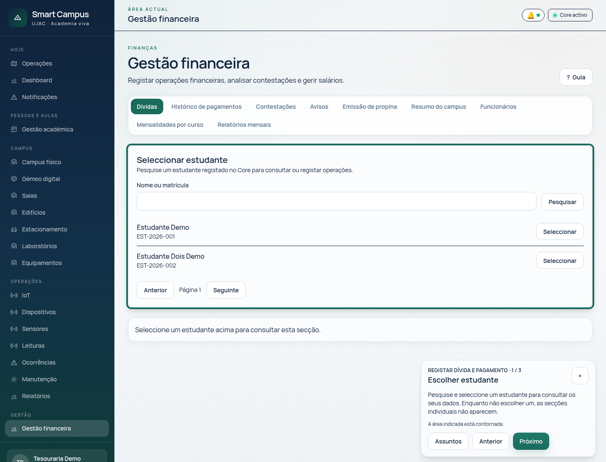
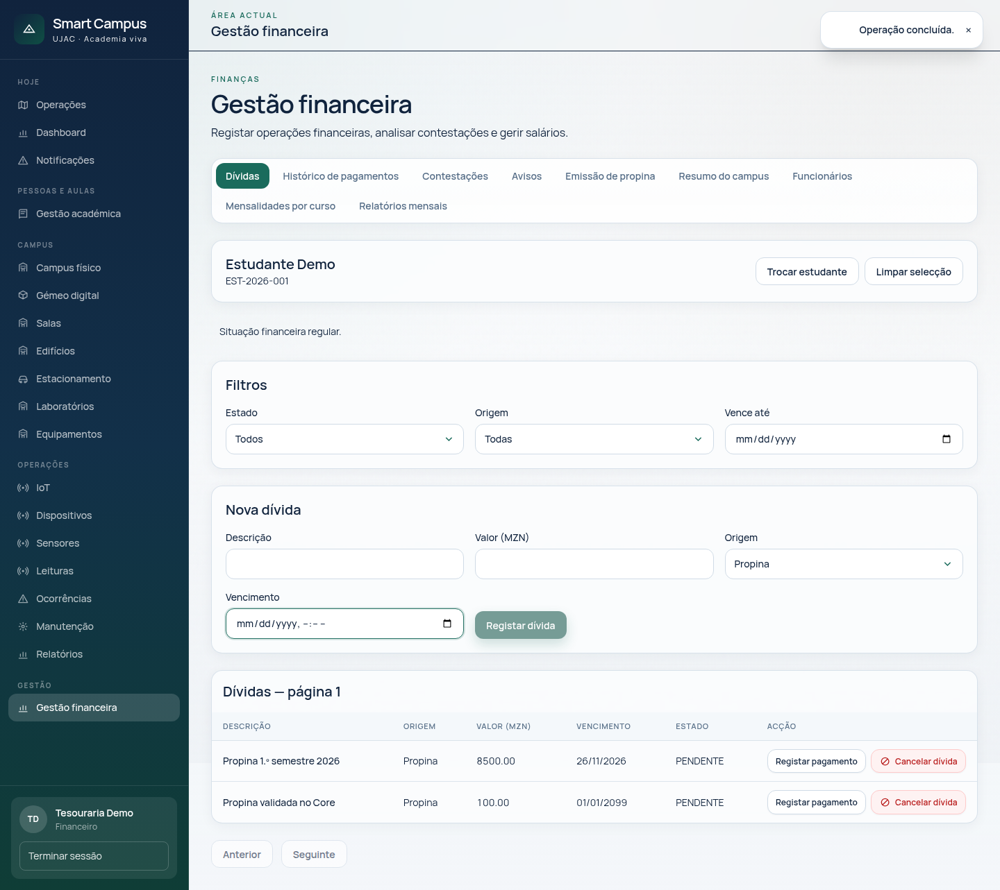
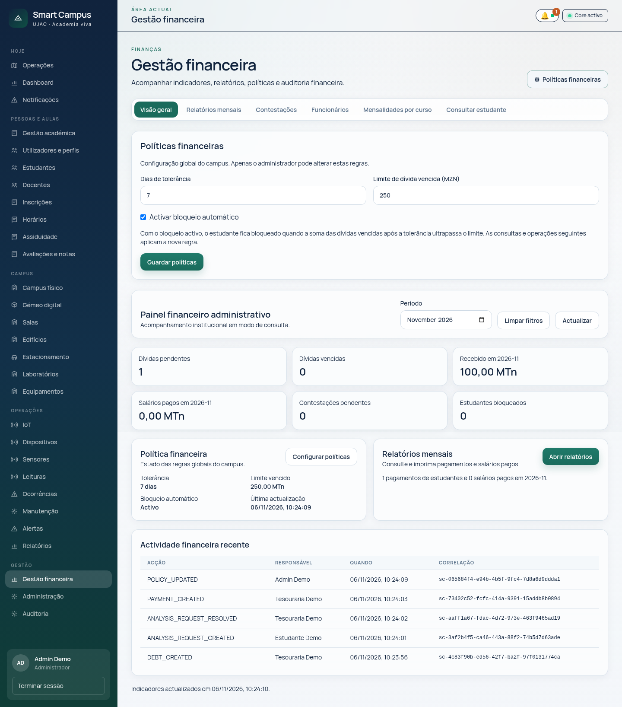
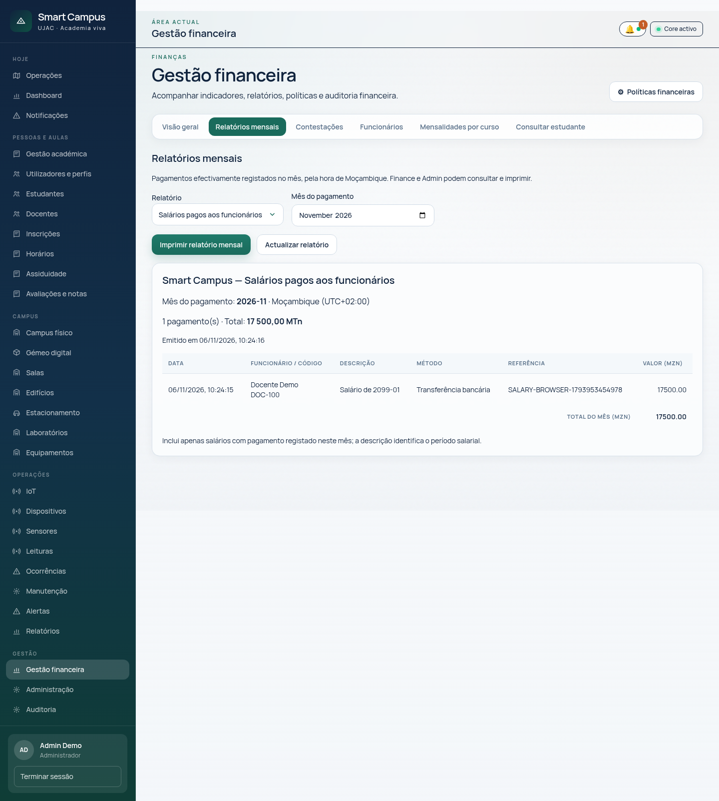
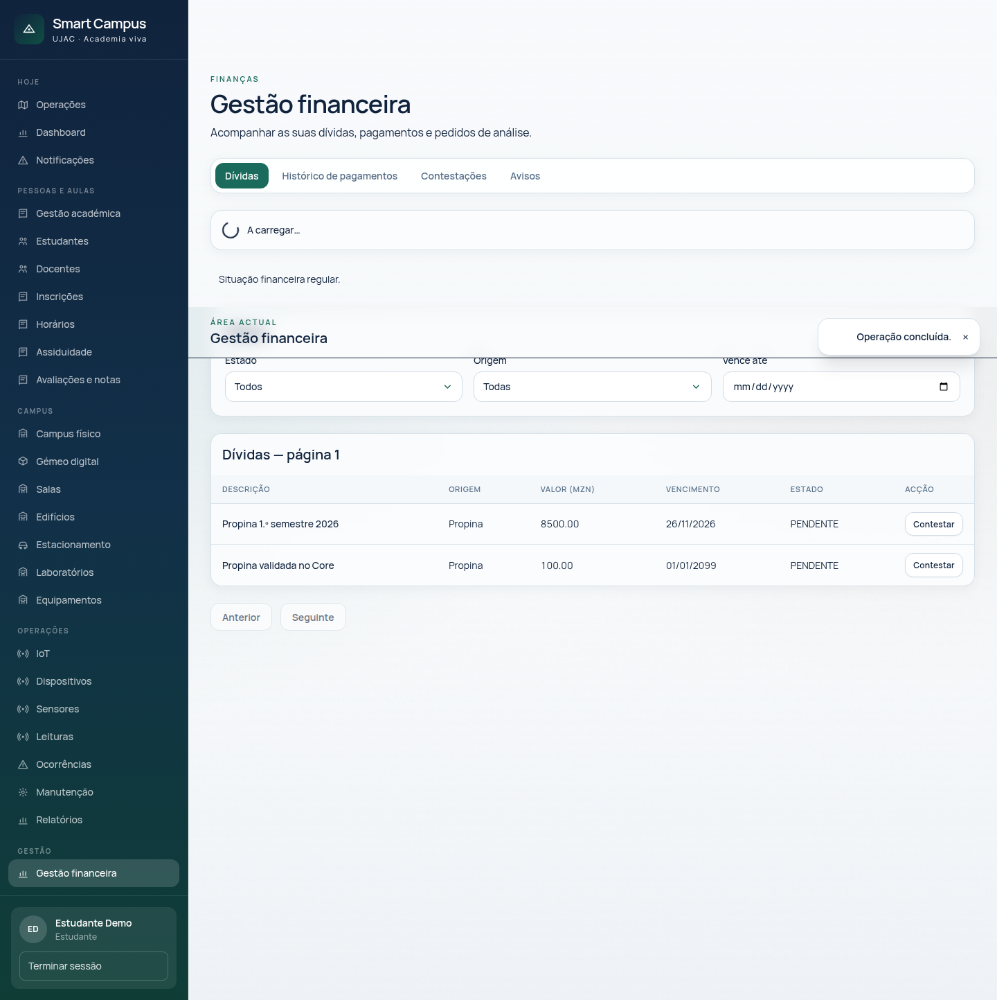

# Manual de utilização — Gestão financeira

Este manual descreve as opções implementadas na interface do Smart Campus. Os nomes de estudantes, funcionários, dívidas e pagamentos usados num ensaio devem ser de demonstração. A existência de uma conta no sistema não comprova que existam dados reais importados.

## Acesso

1. Abra a aplicação e inicie sessão com uma conta autorizada.
2. No menu, abra **Gestão financeira** (`/financial`).
3. Os separadores e botões dependem do perfil. Se surgir uma mensagem de acesso negado, confirme a conta e contacte o administrador; não partilhe a palavra-passe.

| Perfil | Utilização principal |
| --- | --- |
| FINANCE | Consulta estudantes e regista dívidas e pagamentos; decide contestações; emite propinas; gere mensalidades e operações salariais. |
| ADMIN | Consulta visão geral, relatórios, estudantes, contestações, funcionários e mensalidades; define políticas e decide propostas de salário. |
| STUDENT | Consulta apenas a sua pasta financeira, recibos, contestações e avisos; pode contestar uma dívida. |

O módulo académico mantém os perfis de estudantes e docentes. A gestão financeira usa os registos partilhados disponíveis no Core; uma actualização de código não importa automaticamente estudantes reais.

## Guia interactivo

Na página **Gestão financeira**, escolha **? Guia** para abrir a ajuda e seleccione um dos casos disponíveis para o seu perfil. O guia abre a secção correspondente e destaca a área relacionada com cada passo. Use **Anterior** e **Próximo** para percorrer as instruções; pode terminar o guia ou premir **Esc** para o fechar a qualquer momento.

- **STUDENT:** consultar dívidas e pagamentos, contestar cobrança e consultar avisos.
- **FINANCE:** registar dívida e pagamento, analisar contestações, gerir salários, emitir propinas e consultar relatórios.
- **ADMIN:** consultar estudante, decidir propostas salariais, consultar relatórios e configurar políticas.

O guia explica o que fazer e não confirma operações por si. Algumas áreas só aparecem depois de seleccionar um estudante ou quando existem dados, como uma dívida ou uma proposta salarial. Nesse caso, siga a instrução apresentada no próprio guia.

## Financeiro: consultar estudante e registar cobrança

1. Em **Dívidas**, pesquise o estudante pelo nome ou número de estudante e escolha **Seleccionar**.
2. Consulte a situação financeira e as dívidas. Utilize os filtros de estado, origem e vencimento quando necessário.
3. Em **Nova dívida**, preencha título, valor em meticais, origem e vencimento; confirme a criação.
4. Para registar um pagamento já efectuado, escolha **Registar pagamento** na dívida, indique o método e a referência e confirme. Consulte **Histórico de pagamentos** para imprimir o recibo.
5. Caso uma dívida seja indevida, use a acção **Cancelar dívida** e siga a confirmação apresentada.

O registo documenta uma operação realizada; não executa uma transferência nem comprova integração com banco ou carteira móvel. Confira o método e a referência antes de gravar.

## Contestações e avisos

O estudante pode escolher **Contestar** numa dívida e indicar o motivo. Depois acompanha o pedido em **Contestações**. O Financeiro abre **Contestações**, filtra por estado, escolhe **Analisar**, selecciona aceitar ou rejeitar, escreve a justificação e regista a decisão. O Administrador pode consultar os pedidos.

Em **Avisos**, o estudante lê as suas mensagens. O Financeiro e o Administrador consultam os avisos do estudante seleccionado e o respectivo estado de envio; o Financeiro pode tentar novamente envios pendentes ou falhados. O estado de envio não confirma a leitura pelo estudante.

## Propinas e mensalidades

Em **Mensalidades por curso**, o Financeiro pesquisa o curso, escolhe **Definir mensalidade** ou **Alterar mensalidade**, informa o valor e eventuais observações e guarda. O Administrador pode consultar os valores.

Para emitir propinas em lote, o Financeiro abre **Emissão de propina**, escolhe curso e ano lectivo, introduz valor, vencimento e, se necessário, título, e selecciona **Emitir propinas**. Reveja a quantidade criada e as cobranças já existentes. A emissão depende das inscrições activas disponíveis para o curso e ano seleccionados; uma mensalidade configurada é um registo separado, pelo que deve confirmar o valor no formulário de emissão.

## Funcionários e salários

1. Como FINANCE, abra **Funcionários** e pesquise pelo nome, código ou função. Pode filtrar por categoria e estado.
2. Para um funcionário existente, seleccione **Propor salário**, introduza o valor e a justificação e escolha **Enviar para aprovação**.
3. Como ADMIN, abra **Funcionários** e, em **Aprovações salariais**, consulte a proposta, escreva a nota da decisão e escolha **Aprovar salário** ou **Rejeitar**. Uma proposta só altera o salário após aprovação.
4. Com um salário aprovado, o FINANCE selecciona **Gerar salário mensal**, indica o mês e confirma. Em **Pagamentos salariais**, selecciona o período e usa **Registar pagamento salarial** para informar método e referência de um pagamento já realizado.
5. Após o pagamento registado, use **Imprimir comprovativo salarial**.

O Financeiro pode também usar **Adicionar funcionário externo**, preenchendo código, nome, categoria e função. Este cadastro apoia a gestão financeira e não substitui um sistema completo de recursos humanos nem o cadastro académico.

## Administrador: políticas e supervisão

Na **Visão geral**, consulte os indicadores e aceda aos relatórios. Para examinar uma pasta individual, abra **Consultar estudante**, seleccione a pessoa e escolha **Dívidas**, **Histórico de pagamentos** ou **Avisos**.

Em **Políticas financeiras**, o ADMIN pode ajustar as regras disponíveis, incluindo período de carência, limite e bloqueio automático. Confirme o impacto com os responsáveis antes de guardar: a situação financeira pode afectar operações académicas.

Em **Relatórios mensais**, escolha o tipo e o mês, reveja as linhas e totais e utilize **Imprimir relatório mensal**. O relatório de salários inclui pagamentos registados para funcionários do Core e externos.

## Estudante: consultar a própria pasta

1. Inicie sessão como estudante e abra **Gestão financeira**.
2. Consulte a situação e as **Dívidas**. Abra uma dívida e use **Contestar** se precisar de análise.
3. Em **Histórico de pagamentos**, consulte os pagamentos registados e imprima o recibo disponível.
4. Acompanhe o pedido em **Contestações** e leia as mensagens em **Avisos**.

Se a informação estiver incorrecta ou a conta bloqueada, contacte a tesouraria. A disponibilidade de recibos e relatórios depende de existirem movimentos registados.

## Verificação para demonstração

Utilize uma base de ensaio com dados fictícios autorizados. Verifique separadamente os perfis FINANCE, ADMIN e STUDENT: selecção de estudante, dívida e pagamento de teste, consulta pessoal, proposta e decisão salarial e emissão de comprovativo. Confirme também que um perfil sem autorização não consegue aceder à área. As imagens deste manual foram obtidas em 6 de novembro de 2026 num ensaio automatizado isolado; devem ser revistas pela equipa antes da apresentação.
